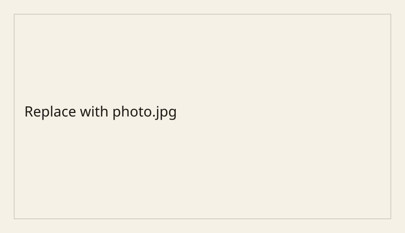

このフォルダは雛形です。名前が `_` で始まるので、サイトには出ません。

コピー先の例:

```text
content/posts/2026-10-20-static-fire/
  index.md
  photo.jpg
```

本文中の画像は、同じフォルダからの相対パスで書きます。



公開するときは `draft: true` を消し、フォルダ名の先頭の `_` も外してください。
