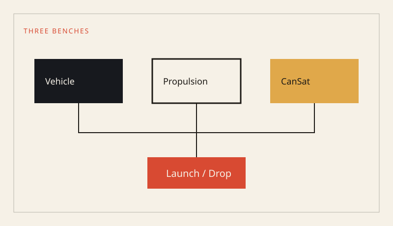

人数が少ないうちに班を細かく割ると、班名だけが残って人が足りなくなります。逆に全部を一つの「開発」にすると、試験の日に誰が弁を見て誰が記録するかが決まりません。

いま置く名前は三つです。

- ハイブリッドロケット: 機体としてまとめる
- 推進・地上試験: 飛ばす前に燃焼を閉じる
- CanSat: ミッションと通信を短い周期で回す

電装は独立した班にせず、ロケットと CanSat の両方に席を作ります。基板だけを見る人と、それが載る機体を見る人が分かれると、コネクタの話が当日になります。

この分け方は固定ではありません。人が増えたら、構造と回収を機体から分ける余地はあります。分ける条件は、その席の記録が二週連続で更新されていることです。
