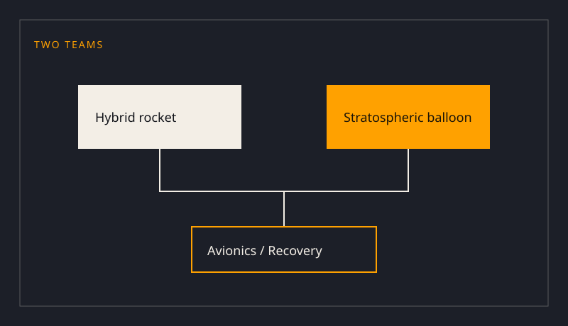

人数が少ないうちに班を細かく割ると、班名だけが残って人が足りなくなります。逆に全部を一つの「開発」にすると、試験の日に誰が弁を見て誰が記録するかが決まりません。

WSPがやるのは二つです。

- ハイブリッドロケット: 機体を作り、地上で燃やし、打上げて回収する
- 成層圏気球: ペイロードを作り、放球し、上空で撮って測り、回収する

二つは推進の有無も、一回の準備にかかる期間も違います。ロケットは燃焼試験を重ねてから一回の打上に向かい、気球は一回の放球で高い高度まで届きます。

共通しているのは、最後に「回収」があることです。電装は独立した班にせず、両方の班に席を作ります。GPS、無線、地上局、パラシュートは、ロケットにも気球にも要ります。基板だけを見る人と、それが載る機体を見る人が分かれると、コネクタの話が当日になります。

この分け方は固定ではありません。人が増えたら、構造と回収を機体から分ける余地はあります。分ける条件は、その席の記録が二週連続で更新されていることです。
